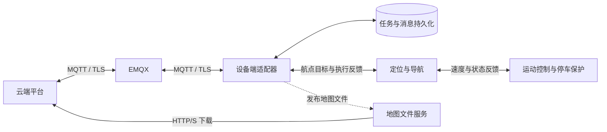

# RTSF 云端对接文档

RTSF 定义云端平台与机器狗之间的任务控制、设备状态、地图和运行轨迹接口。协议版本为 `1.0`，使用 MQTT 交换消息，使用 HTTP(S) 下载地图文件。

## 系统架构

| 参与方 | 职责 |
|---|---|
| 云端平台 | 创建任务、选择航点、下发控制，展示并保存状态、事件和轨迹 |
| EMQX | 连接认证、Topic 授权、消息转发及最新属性保存 |
| 设备端适配器 | 校验请求、维护任务状态、调用导航、上报数据、缓存待发送消息 |
| 定位与导航 | 提供 map 坐标位姿，规划航点之间的可行路径并避障 |
| 运动控制与停车保护 | 检查运动许可、执行速度指令、反馈运动状态与停稳结果 |
| 地图文件服务 | 保存地图 ZIP，提供云端可访问的下载地址 |

云端下发的是依次到达的航点。设备端负责航点之间的路径规划；实际运行轨迹由定位结果生成，不等同于航点连线。

## 接口分类

| 类别 | 内容 | 交互方式 |
|---|---|---|
| 服务 | 下发航点、启动、暂停、恢复、取消 | 云端请求，设备端回复受理结果 |
| 属性 | 设备、地图、任务的当前状态 | 设备端上报，保留最新快照 |
| 事件 | 任务状态变化、故障发生与解除 | 设备端按变化通知 |
| 轨迹 | 实际运行样本 | 设备端分批上报，按编号判断完整性 |

## 文档目录

| 文档 | 解决的问题 |
|---|---|
| [接入指南](接入指南.md) | 如何准备连接、账号、权限并完成首次对接 |
| [通信协议](通信协议.md) | Topic、公共字段、重试与消息关联规则 |
| [任务接口](任务接口.md) | 如何下发航点、控制任务、处理状态与结果 |
| [设备与地图](设备与地图.md) | 如何判断在线、处理故障、下载并解释地图 |
| [轨迹接口](轨迹接口.md) | 如何接收、去重、补传与保存实际轨迹 |
| [错误码](错误码.md) | 请求为何被拒绝、任务为何失败 |
| [联调指南](联调指南.md) | 如何校验报文并验收完整业务流程 |

`schemas/` 提供 JSON Schema，`examples/` 提供完整报文与地图样例。样例使用 `go2-01`、`task-001`、`map-001`；实际对接以部署参数和设备上报为准。
