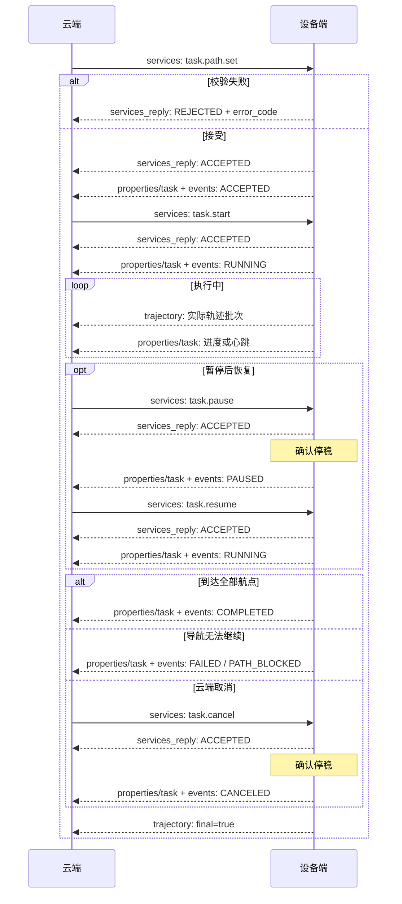

# 任务接口

本文定义航点下发、任务控制、受理回复和任务状态。每台设备同时最多一个非终态任务；航点接收成功后不会自动运动，需另行启动。

## 服务调用

**Topic：** `rtsf/v1/{robot_id}/services`，云→设备，QoS 1，retain=false。

| method | 作用 | 合法前置状态 | 结果 |
|---|---|---|---|
| task.path.set | 创建任务或更新航点 | 新任务或已有非终态任务 | 新任务进入 ACCEPTED；更新保持原状态 |
| task.start | 启动任务 | ACCEPTED | RUNNING |
| task.pause | 暂停任务 | RUNNING | 确认停稳后 PAUSED |
| task.resume | 恢复任务 | PAUSED | RUNNING |
| task.cancel | 取消任务 | ACCEPTED、RUNNING、PAUSED | 确认停稳后 CANCELED |

### 下发航点：task.path.set

| 参数 | 类型 | 必填 | 说明 |
|---|---|---|---|
| task_id | string | 是 | 任务唯一标识 |
| map_id | string | 是 | 与设备当前地图一致 |
| path.path_id | string | 是 | 路径标识，同一任务不变 |
| path.version | integer | 是 | 从 1 起，内容更新时递增 |
| path.waypoints | array | 是 | 1–500 个航点，依次到达 |
| expire_at | int64 | 是 | UTC 毫秒，建议初次下发时间 +600000 |

| 航点参数 | 类型 | 必填 | 说明 |
|---|---|---|---|
| seq | integer | 是 | 从 0 连续递增 |
| x、y | number | 是 | map 坐标，m |
| yaw | number | 否 | 到达朝向，rad；省略表示不约束 |
| type | string | 否 | 省略或 MUST_REACH |

设备端在航点之间规划和避障，不保证沿航点连线行走。到达使用设备端默认容差。不支持 VIA、逐点速度、逐点容差或到点动作；提交这些已定义功能时拒绝整条路径。

接收时检查结构、有效期、地图、能力、航点可导航性和设备就绪。bounds 内部可能存在障碍或未知栅格，不能仅检查坐标范围。无效请求不创建任务；错误码见[错误码](错误码.md)。

完整报文：[task.path.set](examples/task_path_set.json)。

### 启动、暂停、恢复、取消

四个控制服务的 data 均只需 task_id。完整报文：[启动](examples/task_start.json)、[暂停](examples/task_pause.json)、[恢复](examples/task_resume.json)、[取消](examples/task_cancel.json)。

START 和 RESUME 再检查任务绑定的地图、有效期、定位和设备就绪。expire_at 控制路径接收与启动时效，不是运行中的自动取消时间。

同一任务控制尚未完成时，新的服务请求拒绝 INVALID_TRANSITION，原请求重传仍返回原回复。本地保护停车独立生效。

### 更新航点

同一任务使用原 task_id、原 path_id 和新 message_id 下发。

| path.version | 处理 |
|---|---|
| 小于当前值 | 拒绝 STALE_PATH_VERSION |
| 相等、内容相同 | 接受但不重置进度、revision 或有效期 |
| 相等、内容不同 | 拒绝 PATH_VERSION_CONFLICT |
| 大于当前值 | 完整校验通过后替换；失败时旧任务不受影响 |

内容比较 map_id 和已识别的 path 字段，忽略信封、expire_at 与未知扩展字段；省略 type 与 MUST_REACH 等价。同版本请求仍检查地图与请求有效期。

RUNNING 中更新成功时，先封存旧版本轨迹，停止旧导航，再从新路径 seq=0 继续；ACCEPTED 或 PAUSED 时更新不自动运行。快照 revision 递增，状态未变不产生状态变化事件。修改 path_id 拒绝 SCHEMA_INVALID，终态任务拒绝更新。

## 服务回复

**Topic：** `rtsf/v1/{robot_id}/services_reply`，设备→云，QoS 1，retain=false。

method 与请求相同，公共字段 request_id 引用原请求 message_id。

| 参数 | 类型 | 必填 | 说明 |
|---|---|---|---|
| task_id | string | 接受时必填 | 请求对应任务；拒绝时可提取则携带 |
| result | string | 是 | ACCEPTED 或 REJECTED |
| error_code | string | 拒绝时必填 | 机器可识别的错误码 |
| error_msg | string | 否 | 拒绝原因的可读说明 |

完整报文：[接受](examples/service_accepted.json)、[拒绝](examples/service_rejected.json)。

受理回复不是执行完成通知。导航启动等操作在受理后失败，通过任务 FAILED 报告，不修改已发出的回复。

## 任务属性：task.state

**Topic：** `rtsf/v1/{robot_id}/properties/task`，设备→云，QoS 1，retain=true。

任务状态、路径或进度变化时立即上报；RUNNING 和 PAUSED 每 5 秒上报一次。完整报文：[任务属性](examples/task_state.json)。

| 参数 | 类型 | 必填 | 说明 |
|---|---|---|---|
| task_id | string | 是 | 任务标识 |
| revision | int64，≥1 | 是 | 该任务快照修订号，内容变化递增 |
| status | string | 是 | 见状态表 |
| path_id | string | 是 | 当前路径 |
| path_version | integer，≥1 | 是 | 当前路径版本 |
| current_wp_seq | integer，≥0 | 否 | 当前前往航点；终态不携带 |
| progress | number，0–1 | 否 | 已到达航点数 / 总数；完成时为 1 |
| error_code | string | FAILED 时必填 | 运行失败原因 |

| status | 含义 | 是否终态 |
|---|---|---|
| ACCEPTED | 航点已接收，等待启动 | 否 |
| RUNNING | 执行中 | 否 |
| PAUSED | 已停稳并暂停 | 否 |
| COMPLETED | 所有航点完成 | 是 |
| CANCELED | 已取消且停稳 | 是 |
| FAILED | 执行失败 | 是 |

ACCEPTED 和 PAUSED 也占用设备。终态不可恢复，重新执行使用新 task_id。FAILED 不单独证明物理停稳。

retained 保存当前或最近一次任务，不是任务列表。设备空闲时可能仍有最近终态快照，当前占用以 device.state.active_task_id 为准。进程重启后不自动恢复运动，原非终态任务以 FAILED/INTERNAL_ERROR 结束，revision 不重置。

## 状态事件：task.state_changed

**Topic：** `rtsf/v1/{robot_id}/events`，设备→云，QoS 1，retain=false。

状态改变时发布。data 为上述任务属性，额外必填 previous_status；新任务为 null→ACCEPTED，后续转换遵循服务表和终态规则。属性与事件使用同一 revision，仅进度或路径版本变化不产生该事件。

完整报文：[任务状态事件](examples/task_state_changed.json)。

## 交互流程

下图 Topic 均省略公共前缀。不同 Topic 的到达顺序可能变化，云端按 request_id 与 revision 关联处理。

遇障由设备端先绕障或重规划，无法继续时失败，不自动切换为 PAUSED。START/RESUME 被拒绝时，状态保持不变。
