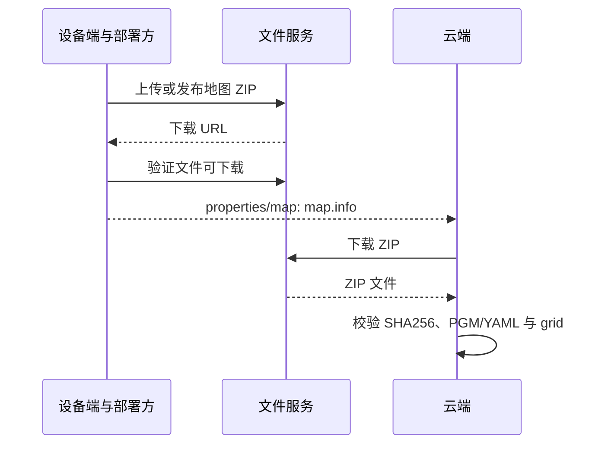

# 设备与地图

本文定义设备在线状态、故障通知和地图元数据，供云端判断设备可用性并正确显示地图。

## 设备属性：device.state

**Topic：** `rtsf/v1/{robot_id}/properties/device`，设备→云，QoS 1，retain=true。

上线、重连或状态变化时上报，每 5 秒心跳。完整报文：[在线](examples/device_state.json)、[离线遗嘱](examples/device_offline.json)。

| 参数 | 类型 | 必填 | 说明 |
|---|---|---|---|
| online | boolean | 是 | 设备是否在线 |
| source | string | 是 | 在线 REPORT；异常离线 LWT；正常关闭 SHUTDOWN |
| state | string | 在线时必填 | IDLE、BUSY、ERROR |
| map_id | string | 否 | 当前地图版本 |
| battery_pct | number，0–100 | 否 | 电量百分比；缺省表示未知 |
| active_task_id | string | 否 | 当前非终态任务；无任务时不携带 |

设备状态与任务状态分开。设备可在线但 ERROR；有任务通常 BUSY，异常时也可 ERROR 并保留 active_task_id。离线不等于停稳，故障解除不自动恢复任务。在线判定见[接入指南](接入指南.md#上线与离线)。

## 故障事件：device.fault

**Topic：** `rtsf/v1/{robot_id}/events`，设备→云，QoS 1，retain=false。

故障发生或解除时上报。完整报文：[故障事件](examples/device_fault.json)。

| 参数 | 类型 | 必填 | 说明 |
|---|---|---|---|
| fault_id | string | 是 | 一次故障的生命周期标识 |
| error_code | string | 是 | 运行错误码或 ROBOT_NOT_READY |
| active | boolean | 是 | true 表示发生，false 表示解除 |
| detail | string | 否 | 可读诊断 |
| task_id | string | 否 | 受影响任务 |

发生与解除使用同一 fault_id、不同 message_id；重复投递保持原 message_id。云端按消息 ID 去重，保存故障生命周期。事件不提供业务确认或历史补拉，需持续订阅并可靠保存。

## 地图属性：map.info

**Topic：** `rtsf/v1/{robot_id}/properties/map`，设备→云，QoS 1，retain=true。

上线、重连、地图或参考点变化时上报。完整报文：[地图元数据](examples/map_info.json)，配套文件：[地图 ZIP](examples/map/map-001.zip)。

| 参数 | 类型 | 必填 | 说明 |
|---|---|---|---|
| map_id | string | 是 | 地图与坐标解释版本 |
| base_frame_id | string | 是 | 轨迹位姿对应的机器人参考坐标系 |
| bounds | object | 是 | min_x/min_y/max_x/max_y，地图外接矩形，m |
| grid.resolution_m | number，>0 | 是 | 每格边长，m |
| grid.width/height | integer，≥1 | 是 | 栅格列数/行数 |
| grid.origin | object | 是 | 栅格原点在 map 中的 x/y/yaw，m/rad |
| map_file.url | string | 是 | HTTP(S) 下载地址 |
| map_file.format | string | 是 | 固定 ROS_MAP_ZIP，包内含 PGM 和 YAML |
| map_file.sha256 | string | 是 | 整个 ZIP 原始字节的 SHA256，64 位十六进制 |
| origin | object | 否 | 地理原点，lat/lon 必填，alt 可选 |
| heading_deg | number | 否 | map x 轴相对正东的逆时针角度，度 |

lat 范围 [-90,90]，lon 范围 [-180,180]；alt 为 m，使用前约定高程基准。顶层 origin 是可选地理配准，grid.origin 是平面栅格原点。未提供足够配准信息时不能自行转换经纬度。

同一 map_id 的文件、栅格和参考点定义保持不变，URL 可更新。换图、重建或参考点定义改变时使用新 map_id。云端按版本保存元数据，避免当前地图覆盖历史轨迹的坐标解释。

### 文件交付



MQTT 只传地图元数据。云端校验整个 ZIP 的 SHA256，检查 PGM 尺寸、YAML 图像引用、分辨率和原点。数值比较允许绝对误差不超过 1e-9 的浮点序列化差异，SHA256 仍按字节精确匹配。

### 坐标说明

航点和轨迹均使用设备端 map 坐标。yaw=0 沿 x 正方向，逆时针为正；base_frame_id 指明轨迹参考点，不能只凭坐标系名称假定它是机身几何中心。

栅格 u 从左向右，v 从下向上，PGM 行号从顶部开始：`row=height-1-v`。设分辨率 r、原点 (ox,oy,θ)，栅格中心坐标为：

```text
dx = (u + 0.5) × r
dy = (v + 0.5) × r
x = ox + cos(θ) × dx - sin(θ) × dy
y = oy + sin(θ) × dx + cos(θ) × dy
```

bounds 内部不一定可通行。占用和未知区域按 YAML 的阈值、negate 及设备外形检查，由设备端最终判定航点是否可导航。
